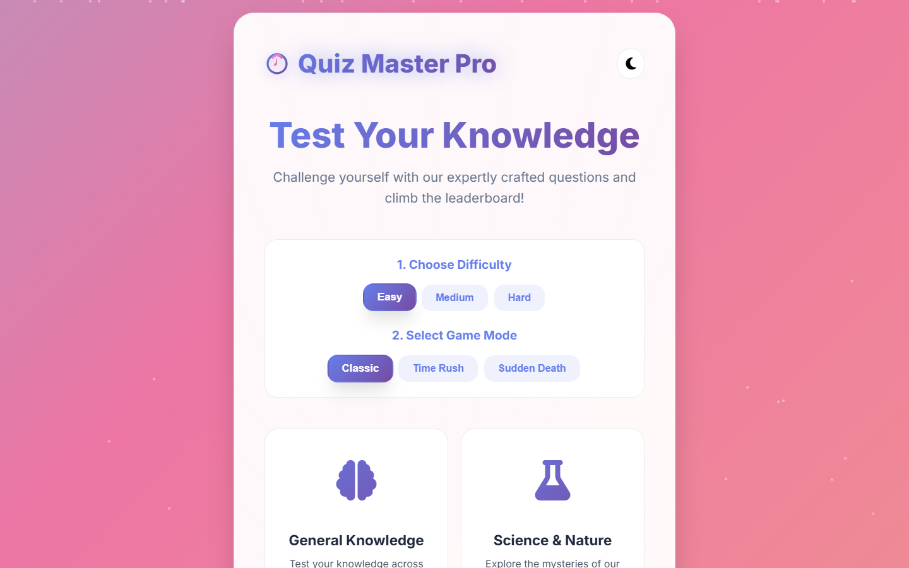

# Quiz Master Pro

A modern, responsive trivia game with three game modes, lifelines, streak bonuses and a dark mode. Questions are pulled live from the [Open Trivia Database](https://opentdb.com/).



**[Play it in the browser](https://vaas125.github.io/quiz-master-pro/)**

## Features

- **Three game modes**
  - *Classic*: 10 questions with a 30-second timer each
  - *Time Rush*: answer as many questions as you can against a 90-second clock
  - *Sudden Death*: one wrong answer ends the game
- **Three difficulty levels** (easy, medium, hard) and multiple categories
- **Live content**: thousands of questions fetched from OpenTDB
- **50:50 lifeline** that removes two wrong answers
- **Streak bonuses** for consecutive correct answers
- **Statistics**: score, streak, accuracy and per-category performance, saved in `localStorage`
- **Dark and light themes** that remember your choice
- **Glassmorphism UI**, smooth animations and confetti celebrations
- Fully responsive, from phone to desktop

## Tech stack

HTML5, CSS3 (custom properties, Grid, Flexbox, animations), vanilla JavaScript (ES6+, async/await, `fetch`, `localStorage`), Font Awesome, OpenTDB API.

## Run locally

No installation is required. An internet connection is needed to fetch questions.

```bash
git clone https://github.com/vaas125/quiz-master-pro.git
cd quiz-master-pro
python -m http.server 8000   # or: npx serve .
```

Then open `http://localhost:8000`. Opening `index.html` directly also works.

## Project structure

```
index.html            Entry point
assets/
  css/style.css       Styles, themes and animations
  js/app.js           Game logic, API calls, scoring and statistics
docs/                 Screenshot
```

## License

[MIT](LICENSE) © Arif Enes
